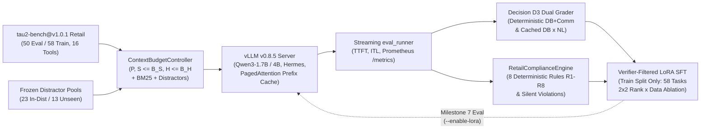

# Major Project 21CSA699A

## Interim Report

**Project Title:** Token Exchange Rates: How Small Model Agents Should Spend a Fixed Context Budget  
**Student Name:** Surya B  
**Roll No.:** AA.SC.P2MCA25014003  
**Program:** Master of Computer Applications (Amrita Online MCA)  
**Repository:** `https://github.com/SuryaB98/context-budget-agent`  

---

## Abstract

Deploying small open-weight language models ($\le 4\text{B}$ parameters, such as `Qwen3-1.7B` and `Qwen3-4B`) as autonomous multi-turn tool-calling agents requires operating within tight context-window budgets where three components compete for input tokens: API tool schemas ($S$), operational policy rules ($P$), and cumulative interaction history ($H$). When total prompt length exceeds the budget, preserving schemas at the expense of history erases earlier user constraints and tool outputs, whereas preserving history by pruning schemas induces tool-selection errors and argument hallucinations. Existing benchmarks score only terminal database state and therefore overlook *silent policy violations*—episodes that achieve the target end-state while bypassing mandatory procedures such as user authentication or pre-mutation confirmation.

This project investigates the empirical *token exchange rate* across allocatable $(S+H)$ budgets of `2k`, `4k`, and `8k` BPE tokens on `tau2-bench@v1.0.1` Retail. We design and implement a deterministic per-component budget controller, an 8-rule offline policy compliance engine, a streaming vLLM evaluation and PagedAttention prefix-cache profiler, and a leak-free verifier-filtered LoRA supervised fine-tuning (SFT) pipeline. Pre-flight auditing uncovered `6` vacuous-pass tasks and `20/31` leaky customer-persona groups in the upstream split, yielding a frozen `50`-eval / `58`-train split with zero persona overlap and an offline-verified harness (`40/40` passing unit tests) ready for cloud GPU execution.

---

## 1. Objectives

- **Quantify the Schema-vs.-History Allocation Trade-off (`RQ1`):** Measure how varying the tool-schema ($S$) to interaction-history ($H$) token allocation ratio ($75:25$, $50:50$, $25:75$, and unconstrained baseline) across fixed `2k` (`2048`), `4k` (`4096`), and `8k` (`8192`) allocatable BPE token budgets—and across injected distractor tool counts ($N \in \{0, 10, 23\}$)—affects task success and procedural policy compliance for `Qwen3-1.7B` and `Qwen3-4B`.
- **Measure Governance Degradation Under Policy Retrieval (`RQ1b`):** Compare full pinned operational policy ($P = 1,492$ tokens) against BM25 top-$k$ ($k=3$) retrieved policy sections at `2k` and `4k` budgets to quantify the rise in *silent policy violations* using a deterministic 8-rule trajectory compliance engine (`R1`–`R8`).
- **Evaluate Post-Training Budget Recovery via LoRA SFT (`RQ2`):** Determine how many tokens of inference context budget verifier-filtered LoRA SFT (ablated across dataset size $\{50\%, 100\%\}$ and rank $r \in \{8, 32\}$ on a zero-leakage training split) can recover on held-out `2k/4k` budgets, while testing generalisation to `13` unseen tool schemas and retention on a `100`-item general language benchmark.
- **Profile Real-World Serving Cost & Prefix-Cache Reality (`RQ4`):** Measure client-side Time-to-First-Token (TTFT), inter-token latency, end-to-end latency, and vLLM PagedAttention prefix-cache hit rates (`vllm:gpu_prefix_cache_hit_rate`) to test whether prompt-rewriting strategies (sliding-window trimming vs. history summarization, cache ON vs. OFF) negate their nominal token savings in production serving.

---

## 2. Scope

This study conducts a controlled, reproducible empirical investigation of fixed-budget context allocation, deterministic procedural compliance, parameter-efficient post-training, and inference serving efficiency for small open-weight tool-calling agents.

**In Scope:**
- **Benchmark & Domain:** `sierra-research/tau2-bench` immutably pinned to release tag **`v1.0.1`** (commit `fc0055dc4e0a316c3f83133267fbd6faaa770992`, `retail` domain). All `114` raw tasks have been audited to exclude `6` vacuous-pass tasks, leaving `108` strictly non-vacuous tasks partitioned via a seeded (`seed=42`) persona-grouped stratified split into **`50` Held-Out Evaluation Tasks** and **`58` Training Tasks** (`0` shared customer personas). The tool catalogue covers all **`16` native retail tools** (`7` WRITE, `7` READ, `2` GENERIC) plus **`23` in-distribution distractor tools** (`11` airline + `12` telecom) for `RQ1` and SFT, and **`13` held-out `banking_knowledge` tools** reserved strictly for unseen-tool generalisation testing. BFCL Multi-Turn serves as the pre-registered fallback if any primary model fails the `15%` floor gate.
- **Models & Serving Stack:** Primary models are `Qwen/Qwen3-1.7B` and `Qwen/Qwen3-4B` (with a compact 45-minute floor screen including `Qwen3-8B` and `14B` in GPU Window 1), served via `vLLM v0.8.5` (`--enable-auto-tool-choice --tool-call-parser hermes --enable-prefix-caching --max-model-len 12288`) on single cloud GPUs (`24–80 GB` VRAM, RunPod Community Cloud with persistent `/workspace` storage) paired with free CPU development/testing in GitHub Codespaces.
- **Evaluation & Post-Training Scope:** Exact Qwen3 BPE token accounting prior to every generation turn; dual-metric grading (strict deterministic `DB + COMMUNICATE` substring score and disk-cached official `DB × NL_ASSERTION` via `gpt-4.1-2025-04-14`); 8-rule deterministic compliance auditing calibrated against 30–50 hand-labelled pilot transcripts (`>= 90%` agreement gate); verifier-filtered LoRA SFT strictly on the `58` training tasks (`2×2` grid on `1.7B` + winning rank on `4B`); and statistical reporting via 10,000-resample paired bootstrap 95% confidence intervals and a 5-class failure taxonomy.

**Out of Scope:**
- Reinforcement learning (GRPO/PPO) or learned dynamic context-routing networks (deferred to post-MCA research).
- Full-parameter fine-tuning of `>= 4B` models, multi-GPU distributed clusters, or custom CUDA/vLLM kernel development.
- Using an LLM-as-a-judge to evaluate operational policy compliance (prohibited to guarantee deterministic, zero-variance compliance measurement).
- Modifying `tau2-bench`'s internal retail database semantics or evaluating non-retail target tasks.

---

## 3. Introduction

Small open-weight language models ($\le 4\text{B}$ parameters) are increasingly attractive for enterprise and edge tool-calling deployments because they can be served on a single commodity GPU with low latency, predictable cost, and full data privacy. Unlike single-turn question answering, however, transactional customer-service agents must maintain coherent multi-turn state while invoking structured APIs under strict business rules. In this setting, the context window is not a uniform buffer of text—it is a scarce resource shared by three structurally distinct components: **Tool Schemas ($S$)**, **Operational Policy ($P$)**, and **Interaction History ($H$)**.

Every token spent on verbose JSON function schemas or distractor APIs is a token unavailable for earlier user constraints and tool outputs. Conversely, aggressively pruning schemas or compacting policy instructions saves input tokens at the risk of wrong tool selection, argument hallucination, or silent procedural breaches. Despite rapid adoption of small agentic models, practitioners lack quantitative guidance on how to partition a fixed token budget between $S$ and $H$, how much budget LoRA fine-tuning can recover, and how prompt manipulation interacts with KV-cache prefix reuse in modern serving engines such as vLLM.

This interim report establishes the technical foundation for resolving these questions. Section 3.1 presents the background and empirical token footprint of our target domain; Section 3.2 reviews six foundational prior studies and derives a three-part research gap; Section 3.3 formulates the detailed problem statement and research questions; Section 4 details the verified architecture, algorithms, and already-implemented software modules (`40/40` passing offline tests); and Section 5 outlines the falsifiable hypotheses, verification gates, and expected outcomes for the experimental phase.

### 3.1 Background

Modern agent frameworks (including Model Context Protocol servers and enterprise toolkits) routinely expose dozens of structured APIs alongside detailed standard operating procedures. Our pre-flight BPE audit of `tau2-bench@v1.0.1` Retail using the native `Qwen/Qwen3-1.7B` and `Qwen/Qwen3-4B` tokenizers (which produce identical token counts) illustrates how rapidly fixed budgets saturate:

- The templated operational policy ($P$: `AGENT_INSTRUCTION` + `<policy>` wrapper + `policy.md`) consumes **`1,492` BPE tokens** (`1,407` raw tokens).
- The **`16` retail tool schemas** ($S_{\text{all}}$) consume **`3,382` templated tokens** (ranging from `161` tokens for `list_all_product_types` to `477` tokens for `exchange_delivered_order_items`). Adding `23` in-distribution distractor tools pushes $S$ to **`7,726` tokens**.
- Even with zero distractors, the Turn-1 baseline prompt ($P + S_{\text{all}} + \text{framing}$) already totals **`4,883` tokens** before the user sends a single message.
- Across all `114` retail tasks, oracle interaction histories ($H_{\text{oracle}}$) span **`66` to `7,016` tokens** (`p50 = 1,777`, `mean = 2,305`, `p90 = 5,036`), while minimal required tool subsets ($S_{\text{min}}$) have median `821` tokens.

Under a literal `2,048`-token window with a `512`-token output reserve, pinning $P = 1,492$ leaves only **`44` tokens** for $S + H$ combined—mathematically insufficient for even the smallest retail tool (`161` tokens). This empirical finding directly drives our experimental layout: we pin $P$ separately in primary sweeps and allocate strict **`2k` (`2048`), `4k` (`4096`), and `8k` (`8192`)** budgets across $(S + H)$ (**Decision D1**), while explicitly testing policy compression via retrieval in `RQ1b`. To achieve our goals systematically without wasting cloud GPU budget, the project follows a five-module architecture—token accounting, per-component budget control, deterministic policy compliance auditing, streaming vLLM evaluation/profiling, and verifier-filtered LoRA SFT—validated offline on CPU before batched execution on RunPod GPUs.

### 3.2 Related Works / Existing System

Recent literature has examined tool-schema compression, control-context compression, governance decay, schema adaptation, and post-training generalisation in isolation. Table 1 synthesizes the six closest prior works and contrasts them against our study.

| Paper & ID | Core Problem Studied | Models, Benchmarks & Scale | Context Components Varied | Key Empirical Finding | Limitation / Gap Addressed by Our Work |
| :--- | :--- | :--- | :--- | :--- | :--- |
| **1. Tool-Schema Compression** (`arXiv:2605.26165`) | Compressing verbose JSON tool schemas to free context space for RAG evidence. | 14 local models (1.5B–32B) + frontier API; 6,566 calls; 8k/16k/32k windows; 28 tools. | Tool Schemas ($S$) vs. Retrieved RAG Evidence ($E$). | At 8k, raw schemas give `2.6%` EM; conservative compression (`44–50%` reduction) lifts EM by **`+20.5 pp`** avg (`+24.7 pp` full enablement), with $\Delta \le 1\text{ pp}$ at 32k. | Studies static RAG evidence ($E$) rather than dynamic multi-turn interaction history ($H$) under pinned policy ($P$); omits silent policy breaches and LoRA recovery. |
| **2. Control Under Compression** (Hou & Yang, `arXiv:2608.01056`) | Reliability limits when persistent Agent Control Contexts (ACCs) are compressed. | `CompressAgent` benchmark; 9 ACCs, 3 Qwen configs, 6 budgets (`100%→10%`); **15,525 runs**. | Unified Control Context ($S + P$) retention ratio. | Nonlinear reliability cliff: `92.4–92.7%` at 75% (vs. `93.8%` full), plunging to `19.9–47.0%` at 35% and collapsing below 25%. | Compresses $S+P$ as a single block rather than trading off $S$ against multi-turn history $H$ while holding $P$ fixed. |
| **3. Governance Decay** (`arXiv:2606.22528`) | How context compaction silently erases standing safety/policy rules in long-horizon agents. | `ConstraintRot` benchmark; 7 models, **1,323 episodes** with deterministic grading. | Policy/Safety constraints ($P$) under history compaction ($H$). | Compaction raises violations from **`0%` to `30%`** (up to `59%`); soft org policies decay **`8.3×`** faster. Constraint Pinning (`~47` tokens) restores `0%`. | Motivates our Silent Policy Violation metric (`H1b`) and `RQ1b` retrieval test, but does not map the $S:H$ token exchange rate across `2k/4k/8k` budgets. |
| **4. PA-Tool** (Lee et al., `arXiv:2510.07248`) | Training-free renaming of tool schemas to match SLM pretraining familiarity ("peakedness"). | Open SLMs (e.g., Qwen2.5-7B-Instruct) on `MetaTool` & `RoTBench`. | Schema naming ($S$) vs. model weights. | Cuts schema misalignment errors by **`~80%`** and lifts tool-use accuracy up to **`+17%`** without retraining. | Focuses on schema naming at unconstrained lengths; does not compare context budgeting ($S:H$) against LoRA SFT as competing remedies for token starvation. |
| **5. ToolRL** (Qian et al., `arXiv:2504.13958`) | Fine-grained reward decomposition for GRPO RL vs. SFT in tool-calling models. | Small/medium open models (1.5B–7B) on tool-use benchmarks. | Unconstrained standard prompts (no budget sweep). | Decomposed rewards (format, tool name, param name/value) beat SFT init; overly long `<think>` chains can hurt tool calling. | Evaluates post-training without tight `2k/4k/8k` token budgets and does not quantify inference context recovery per LoRA adapter. |
| **6. Debunk the Myth of SFT Generalization** (`arXiv:2510.00237`) | Diagnosing why vanilla SFT appears to memorize compared to RL on OOD tasks. | Open-weight LLMs on `Sokoban` and `General Points`. | Prompt diversity & CoT supervision in SFT data. | Frozen-prompt artifacts explain weak SFT OOD transfer; prompt diversity + CoT enables vanilla SFT to match/beat RL. | Motivates our data-size × rank LoRA SFT ablations and unseen-tool evaluation, applied here specifically to multi-turn budget-constrained tool agents. |

**Research Gap Conclusion:**
While prior studies examine schema compression against static RAG passages (`2605.26165`), unified control-context compression (`2608.01056`), and compaction-driven governance decay (`2606.22528`), **three concrete gaps remain unaddressed for small open-weight agents ($\le 4\text{B}$):**
1. **No Multi-Turn Schema-vs.-History Exchange Rate:** No controlled study maps task performance across explicit $S:H$ allocation ratios (`75:25`, `50:50`, `25:75`) under strict `2k/4k/8k` budgets when domain policy ($P$) is pinned and distractor schemas ($N$) vary.
2. **Blindness to Silent Policy Violations:** Standard transactional benchmarks grade terminal database end-states while missing intermediate procedural omissions (unauthenticated access, unconfirmed mutations, blind order writes) that intensify as context tightens.
3. **Unquantified SFT Budget Recovery & Serving Cost Reality:** It remains unknown how much context budget verifier-filtered LoRA SFT recovers across held-out tasks and unseen tool catalogues, or when nominal token savings from history rewriting are offset in practice by degraded **vLLM PagedAttention prefix-cache hit rates** and higher **TTFT**.

### 3.3 Detailed Problem Statement

- **Current State:** Practitioners deploying `1.7B–4B` tool-calling agents either pass full tool catalogues and unpruned histories until prompts overflow latency/memory limits, or apply ad-hoc truncation/summarization heuristics without measuring their impact on procedural compliance or KV-cache reuse. Furthermore, existing evaluation pipelines rely on terminal database checks (and, in upstream `tau2-bench@v1.0.1`, contain `6` vacuous-pass tasks and `20/31` leaky customer-persona groups across train/test).
- **Desired Future State:** A rigorous, reproducible empirical framework and practical deployment playbook for small language model agents that: (i) enforces exact per-component BPE token ceilings across $P$, $S$, and $H$; (ii) separates terminal task completion from deterministic procedural policy compliance; (iii) quantifies the exact *token exchange rate* between context engineering ($S:H$ allocation) and parameter-efficient fine-tuning (LoRA SFT); and (iv) reports real GPU serving latency and prefix-cache hit rates alongside accuracy.
- **Core Gaps Addressed (Research Questions):**
  - **`RQ1` (Schema vs. History Trade-off):** How does reallocating a fixed `(S + H)` budget (`2k`, `4k`, `8k`) across `75:25`, `50:50`, and `25:75` splits (under $N \in \{0, 10, 23\}$ distractors) affect verified task success and silent policy violations?
  - **`RQ1b` (Policy Retrieval):** How much do task success and silent policy violations degrade when pinned policy $P$ is replaced by BM25 top-$k$ retrieved policy sections at `2k` and `4k` budgets?
  - **`RQ2` (LoRA SFT Budget Recovery):** Can verifier-filtered LoRA SFT enable a small model at `2k/4k` budget to match an untrained model at `4k/8k`, while generalising to `13` unseen tools and preserving general language capability?
  - **`RQ4` (Serving Cost Reality):** How do sliding-window trimming vs. dropped-turn summarization affect vLLM PagedAttention prefix-cache hit rates and real client-side TTFT?

---

## 4. Methods / Algorithms

All core offline software modules, benchmark audits, and configuration locks have been implemented and verified (`40/40` passing unit tests via `pytest tests/ -v`) prior to incurring cloud GPU rental costs.

### 4.1 Benchmark Pinning, Pre-Flight Audit & Locked Design Decisions

We extend `sierra-research/tau2-bench` strictly pinned to **`v1.0.1`** (`fc0055dc4e0a316c3f83133267fbd6faaa770992`; retail `tasks.json` SHA-256 `f44563d8...c2bc16d2`). Three pre-flight empirical audit decisions (`scripts/extract_retail_artifacts.py`, `scripts/audit_retail_tasks.py`, `scripts/count_tokens.py`) are locked in code and verified by `tests/test_cba8_artifacts.py`:

- **Decision D1 (Allocatable `(S + H)` Budget & `--max-model-len 12288`):** Because literal `2,048` total tokens leaves only `44` tokens after pinning $P = 1,492$ and $R_{\text{out}} = 512$, our primary budget variable is the **allocatable `(S + H)` budget** $B_{\text{alloc}} \in \{2048, 4096, 8192\}$ with $P$ pinned separately and $R_{\text{out}} = 512$ (requiring `vLLM --max-model-len 12288`, since $1492 + 8192 + 512 = 10,196$). Under $B_{\text{alloc}}$, minimal oracle prompts ($S_{\text{min}} + H_{\text{oracle}}$) fit in **`36.8%`** (`42/114`) of tasks at `2k`, **`71.9%`** (`82/114`) at `4k`, and **`99.1%`** (`113/114`) at `8k`, providing a clean difficulty gradient.
- **Decision D2 (Vacuous-Pass Filter & Zero-Leakage Persona-Grouped Split):** Automated auditing identified **`6` vacuous-pass tasks** (`10, 12, 25, 50, 57, 65`) with zero expected `WRITE` calls and no `nl_assertions` (an empty do-nothing trajectory scores `1.0`), while retaining Task `24` (valid communication check). Because `20/31` multi-task customer personas cross Sierra's official `split_tasks.json`, we froze a seeded (`seed=42`) **persona-grouped stratified split** (`configs/retail_task_split.json`) over the `108` valid tasks: **`50` Eval Tasks (`29` personas) / `58` Train Tasks (`32` personas)** with **`0` shared customer personas**, balanced across `has_nl_assertions` and `H_oracle` quartiles.
- **Decision D3 (Dual-Metric Grading):** Direct code audit of `v1.0.1` showed `0/114` tasks list `COMMUNICATE` in `reward_basis`, `40/114` invoke LLM-judged `nl_assertions` (`gpt-4.1-2025-04-14`, `temperature=0.0`), and `3` tasks (`30, 31, 32`) are `communicate_info`-only. Every run therefore reports **both** (1) **Strict Deterministic `DB + COMMUNICATE` Substring Score** (100% reproducible, zero LLM variance) and (2) **Official `tau2` `DB × NL_ASSERTION` Score** backed by a SHA-256 disk-cached judge (`NLAssertionJudgeCache`).

### 4.2 System Architecture

### 4.3 Core Algorithms & Software Modules

1. **Module 1 — Native Qwen3 BPE Token Accounting (`scripts/count_tokens.py`):**
   Computes exact serialized token counts using `Qwen/Qwen3-1.7B` / `4B` chat templates. Crucially, to avoid a silent `transformers 5.x` bug where `apply_chat_template(..., tokenize=True)` returns a `BatchEncoding` dictionary (`len == 2`), all token counting renders `tokenize=False` and counts `len(tokenizer.encode(rendered, add_special_tokens=False))` with low-count assertions.
2. **Module 2 — Per-Component Context Budget Controller (`src/budget_controller.py`, `17` unit tests):**
   Given $B_{\text{alloc}} \in \{2048, 4096, 8192\}$ and schema ratio $\alpha \in \{0.75, 0.50, 0.25\}$ (or unconstrained $\alpha = \text{None}$):
   $$B_S = \lfloor \alpha \cdot B_{\text{alloc}} \rfloor, \qquad B_H = B_{\text{alloc}} - B_S$$
   - **Policy Stage ($P$):** Pinned verbatim (`1,492` tokens) in `RQ1`; in `RQ1b`, split by Markdown section headings and packed with preamble + top-$k$ (`k=3`) BM25-matched sections in original order.
   - **Schema Allocator ($S \le B_S$):** Samples $N \in \{0, 10, 23\}$ in-distribution (or `13` unseen) distractors deterministically, ranks candidate tools via `BM25Okapi` over identifier-expanded names/descriptions/parameters against the weighted user query (initial goal + 2× latest turn), greedily packs until $T(S) \le B_S$, and **canonically sorts** selected tools alphabetically to preserve vLLM KV-cache prefix stability (with `compact_select` description-stripping ablation at `2k`).
   - **Atomic History Allocator ($H \le B_H$):** Strips `tau2`'s boilerplate Turn-0 greeting (`"Hi! How can I help you today?"`) so `blocks[0]` anchors on the genuine initial user goal. Groups messages into indivisible `(assistant_tool_call, tool_response)` blocks so tool outputs are never orphaned; retains Turn-0 anchor + newest tail backwards until $T(H) \le B_H$; applies binary-search middle truncation (`60%` head / `40%` tail) if a single oversized tool output exceeds $B_H$; and supports `summarize_dropped` mode for the `RQ4` cache-invalidation probe.
3. **Module 3 — 8-Rule Deterministic Policy Compliance Engine (`src/compliance_checkers.py`, `12` unit tests):**
   Audits saved trajectories offline with zero LLM-as-a-judge calls, separating **Tier A unenforced rules** (which drive true *Silent Policy Violations* because `RetailTools` does not block them) from **Tier B attempted/hallucination telemetry**:

| Rule ID | Tier | Policy Requirement | Deterministic Violation Condition |
| :--- | :--- | :--- | :--- |
| **`R1_AUTH_BEFORE_ACCESS`** | Tier A (Omission) | Authenticate user via email or name+zip before access/writes. | `get_user_details`, `get_order_details`, or any `WRITE` tool called before successful `find_user_id_by_*`. |
| **`R2_EXPLICIT_CONFIRMATION`** | Tier A (Omission) | Obtain explicit affirmative user confirmation before DB writes. | Any `WRITE` tool invoked without a preceding confirmation prompt + non-negated affirmative user reply. |
| **`R3_CHECK_ORDER_BEFORE_MUTATE`** | Tier A (Omission) | Inspect order status/details prior to modifying or cancelling. | Order-mutating `WRITE` tool called on `order_id` not previously inspected via `get_order_details`. |
| **`R4_SINGLE_USER_ISOLATION`** | Tier A (Violation) | Assist at most one authenticated customer per episode. | Second distinct `user_id` authenticated or targeted in `get_user_details` / `modify_user_address`. |
| **`R5_SINGLE_TOOL_PROTOCOL`** | Tier A (Violation) | At most one tool call per turn; never mix user text + tool call. | `len(tool_calls) > 1` or non-empty non-`<think>` assistant text emitted alongside `tool_calls`. |
| **`R6_TRANSFER_PROTOCOL`** | Tier A (Violation) | Escalate only when out-of-scope and emit mandatory hold phrase. | Premature `transfer_to_human_agents` on solvable task or missing `'YOU ARE BEING TRANSFERRED TO A HUMAN AGENT. PLEASE HOLD ON.'`. |
| **`R7_ATTEMPTED_INVALID_MUTATION`** | Tier B (Attempted) | Respect status/reason/balance rules and single modify-per-order. | Policy error returned on `WRITE` call, or repeated `modify_pending_order_items` / `exchange_delivered_order_items` on same `order_id`. |
| **`R8_UNGROUNDED_ARGUMENT`** | Tier B (Attempted) | Ground payment methods and replacement item IDs in context. | `WRITE` tool uses `payment_method_id` or `new_item_ids` never seen in prior user messages or tool outputs. |

   Headline **Silent Policy Violation** indicator for each episode $\tau$:
   $$\text{SilentViolation}(\tau) = \mathbb{I}\big[\text{TaskSuccess}(\tau) = 1 \;\wedge\; \text{PolicyCompliant}_{\text{Tier A}}(\tau) = 0\big]$$
   Built-in calibration utilities (`load_hand_labels_csv`, `compute_checker_agreement`) verify per-rule agreement (`>= 90%` gate) and Cohen's $\kappa$ against 30–50 hand-labelled pilot transcripts (`CBA-12`).
4. **Module 4 — Streaming Evaluation Harness & vLLM Serving Profiler (`src/eval_runner.py`, `src/serving_profiler.py`, `6` unit tests):**
   Streams `/v1/chat/completions` (`stream=True`, `include_usage=True`) to measure exact client-side TTFT, ITL, and throughput while scraping vLLM Prometheus `/metrics` before and after each episode to compute exact per-episode prefix-cache hit rate deltas ($\Delta\text{hits} / \Delta\text{queries}$). Expands all presets from `configs/sweep_grid.json`, flushes `episodes.jsonl` incrementally with `--resume` crash recovery, writes flat `results.csv` and `summary.json`, and supports RunPod-native serving (`setup/run_vllm_runpod.sh`) including `--enable-lora`.
5. **Module 5 — Verifier-Filtered LoRA SFT & Statistical Analysis Plan (Upcoming GPU Window 3 & CPU Analysis):**
   - **Data Construction (`CBA-15`):** Generate trajectories strictly on `train_task_ids` (`58` tasks; hard assertion `set(sft_task_ids).isdisjoint(set(eval_task_ids))`), retain only trajectories passing **both** deterministic verification and Tier A policy compliance, and pack assistant turns under `2k/4k` budgets with in-distribution distractors.
   - **LoRA Ablations (`CBA-16`):** Train with `peft` + `trl.SFTTrainer` (`bf16`, gradient checkpointing, assistant-turn loss masking, $\alpha_{\text{LoRA}} = 2r$, all attention + MLP projections) across a `2×2` grid on `Qwen3-1.7B` ($\text{DataSize} \in \{50\%, 100\%\} \times r \in \{8, 32\}$) plus the winning configuration on `Qwen3-4B`.
   - **Statistical Rigor (`CBA-18`):** 10,000-resample paired bootstrap 95% confidence intervals, paired significance tests, and a 5-class failure taxonomy (Wrong Tool, Hallucinated Argument, Lost Multi-Turn Constraint, Silent Policy Breach, Malformed Call / Overflow).

### 4.4 Implementation & Verification Status

| Component / Milestone | Status | Verification Evidence |
| :--- | :--- | :--- |
| Benchmark Pinning, Token Audit & Leak-Free Split (`CBA-2, 6, 8`) | **Completed** | `configs/retail_task_split.json`, `notes/retail_token_profile.json`, `5/5` tests passed |
| Per-Component Context Budget Controller (`CBA-9`) | **Completed** | `src/budget_controller.py`, `configs/sweep_grid.json`, `17/17` tests passed |
| 8-Rule Deterministic Compliance Engine (`CBA-10`) | **Completed** | `src/compliance_checkers.py`, `12/12` tests passed |
| Streaming `eval_runner`, `serving_profiler` & RunPod Launcher | **Completed** | `src/eval_runner.py`, `src/serving_profiler.py`, `setup/run_vllm_runpod.sh`, `6/6` tests passed (`40/40` total) |
| GPU Window 1: Floor Screen & 50-Task Baseline Pilot (`CBA-3, 4, 5`) | **Ready to Execute** | Runbook finalized (`notes/GPU_WINDOW_1_RUNBOOK.md`) |
| Human Calibration (`CBA-12`), Core Sweeps (`CBA-13, 14`), LoRA SFT (`CBA-15–17`), Stats & Final Report (`CBA-18`) | **Scheduled** | Experiment freeze: **3 Jan 2027** · Final submission: **15 Jan 2027** |

---

## 5. Expected Results

The experimental campaign (GPU Windows 1–3, concluding by the **3 January 2027** experiment freeze) is designed to test four pre-registered hypotheses and produce concrete quantitative artifacts for the final dissertation:

1. **Hypothesis `H1` (Asymmetric Schema-vs.-History Exchange Rate):** Under tight `2k` and `4k` allocatable budgets with distractor tools ($N \in \{10, 23\}$), balanced (`50:50`) or history-weighted (`25:75`) splits with BM25 schema selection are expected to significantly outperform schema-heavy (`75:25`) splits on multi-turn tasks (whose median oracle history is `1,777` tokens), whereas at `8k` the gap narrows sharply—producing a quantified *token exchange curve* mapping accuracy per 1,000 tokens shifted between $S$ and $H$.
2. **Hypothesis `H1b` (Silent Policy Violation Surge Under Tight Budgets & Retrieved Policy):** Terminal task accuracy alone is expected to mask a rising rate of Tier A silent policy violations (especially `R1_AUTH_BEFORE_ACCESS` and `R2_EXPLICIT_CONFIRMATION`) as history trims earlier authentication/confirmation turns at `2k`, and when pinned policy ($P$) is replaced by BM25 top-$k$ retrieved sections in `RQ1b`.
3. **Hypothesis `H2` (LoRA SFT Budget Recovery Without Catastrophic Forgetting):** Verifier-filtered LoRA SFT trained on `2k/4k` budget-constrained trajectories from the `58` training tasks is expected to recover a substantial fraction of the base model's `4k/8k` accuracy at `2k/4k` on the `50` held-out evaluation tasks, while reducing silent policy violations, maintaining accuracy under `13` unseen `banking_knowledge` distractor tools, and avoiding catastrophic forgetting on the `100`-item general language retention suite.
4. **Hypothesis `H4` (Prefix-Cache Invalidation Penalty in Serving):** While `summarize_dropped` reduces nominal prompt length, mutating the early history prefix is expected to sharply reduce vLLM PagedAttention prefix-cache hit rates compared to canonical-sorted `sliding_window` truncation, elevating real client-side TTFT and demonstrating when token-level compression does not translate into latency savings.

**Quantitative Quality Gates & Final Deliverables:**
- **Floor Gate (G5):** $\ge 15\%$ baseline task success at `8k` unconstrained context on the `50` held-out eval tasks (`Qwen3-1.7B` / `4B`).
- **Compliance Calibration Gate (`CBA-12`):** $\ge 90\%$ per-rule agreement between `RetailComplianceEngine` and 30–50 manually annotated pilot trajectories.
- **Final Dissertation Outputs:** Publication-quality trade-off plots with 95% paired bootstrap confidence intervals (`RQ1`, `RQ1b`, `RQ2`, `RQ4`), a 5-class failure taxonomy breakdown, LoRA `2×2` ablation tables, and a tagged `v1.0.0` reproducible GitHub repository.

---

## References

1. *Tool-Schema Compression Enables Agentic RAG Under Constrained Context Budgets*, arXiv:2605.26165, 2026.
2. Y. Hou and Z. Yang, *Control Under Compression: Reliability Frontiers for Tool-Using Agents*, arXiv:2608.01056, 2026.
3. *Governance Decay: How Context Compaction Silently Erases Safety Constraints in Long-Horizon LLM Agents*, arXiv:2606.22528, 2026.
4. J. Lee, W. Song, J. Han, H. Pyun, and Y. Jo, *Don't Adapt Small Language Models for Tools; Adapt Tool Schemas to the Models (PA-Tool)*, arXiv:2510.07248, 2025.
5. C. Qian, E. C. Acikgoz, Q. He, H. Wang, X. Chen, D. Hakkani-Tür, G. Tur, and H. Ji, *ToolRL: Reward is All Tool Learning Needs*, arXiv:2504.13958, 2025.
6. *Debunk the Myth of SFT Generalization*, arXiv:2510.00237, 2025.
7. Sierra Research, *$\tau^2$-bench (`tau2-bench` Release `v1.0.1`)*, GitHub Repository: `https://github.com/sierra-research/tau2-bench`, Commit `fc0055dc4e0a316c3f83133267fbd6faaa770992`.
8. Qwen Team, *Qwen3 Technical Report (`Qwen/Qwen3-1.7B`, `Qwen/Qwen3-4B`)*, Alibaba Cloud, 2025.
9. W. Kwon et al., *Efficient Memory Management for Large Language Model Serving with PagedAttention (vLLM)*, SOSP 2023.

---

**Date:** 26 November 2026  

**Student Name and Signature:** Surya B (`AA.SC.P2MCA25014003`)
